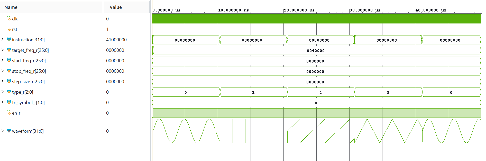
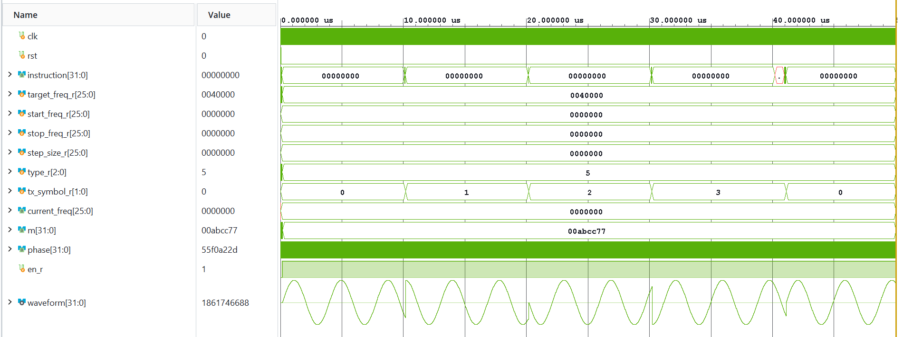
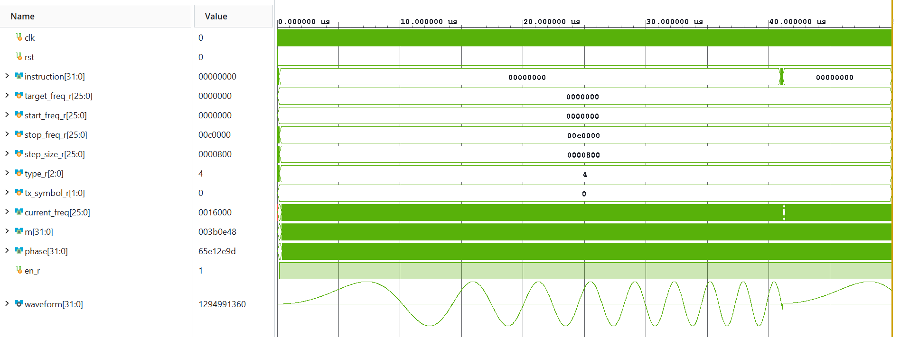

# Processor-Controlled Waveform Generation SoC

A complete RTL design and verification of a **32-bit 5-Stage Pipelined RISC System-on-Chip (SoC)** integrated with a configurable **Direct Digital Synthesis (DDS)** hardware peripheral via a **Memory-Mapped I/O (MMIO)** interface, modeled in Verilog HDL[cite: 1]. 

Rather than relying on inflexible hardwired control logic, this architecture treats waveform parameters as memory-mapped variables, enabling the processor to dynamically schedule multi-waveform synthesis, real-time frequency sweeps, and QPSK phase modulation through standard software load/store instructions[cite: 1, 3, 5].

---

## System Architecture

The SoC couples a custom 32-bit RISC CPU with instruction/data memories and the DDS engine over a shared memory bus[cite: 4]. An MMIO address decoder intercepts targeted memory writes (`is_mmio = 1`) and routes configuration parameters to the DDS peripheral registers while isolating standard RAM traffic (`is_mmio = 0`)[cite: 4, 10].

<!-- IMAGE PLACEHOLDER 1: Replace the path below with your screenshot of Figure 1 (Overall SoC Architecture) -->
```text
                          Processor Core
                                |
                        Memory Interface
                                |
                       mem_addr, mem_data
                                |
                                v
                     +--------------------+
                     |    MMIO Decoder    |
                     +--------------------+
                         /            \
          is_mmio = 0   /              \   is_mmio = 1
                       v                v
            +----------------+    +----------------+
            |  Data Memory   |    | DDS Registers  |
            +----------------+    +----------------+
                       \                /
                        +-------+------+
                                |
                          read_data mux
                                |
                                v
                          Processor Core
```
*Figure 1: High-level routing and MMIO decoding architecture of the integrated SoC[cite: 4].*

### Core Subsystems
* **32-Bit 5-Stage Pipelined RISC Processor:** Executes control software across Fetch (`IF`), Decode (`ID`), Execute (`EX`), Memory (`MEM`), and Write-Back (`WB`) stages, targeting an ideal CPI approaching 1.0[cite: 4, 5].
* **Instruction & Data Memory:** Word-aligned 32-bit ROM for instruction fetch (`PC = PC + 4`) and general-purpose RAM supporting synchronous writes and combinational reads[cite: 6, 8].
* **MMIO Decoder & Shadow-Commit Interface:** Maps peripheral registers into the CPU address space and guarantees glitch-free multi-word parameter updates[cite: 4, 8, 10].
* **Direct Digital Synthesis (DDS) Engine:** Generates high-resolution sine, square, triangle, and sawtooth waveforms alongside automated frequency sweeps and QPSK modulation[cite: 1, 4].

---

## Microarchitecture Highlights

### 1. Five-Stage Pipeline & Hazard Mitigation
The processor implements a 32-bit RISC instruction format (`Opcode`, `Rd`, `Rs1`, `Rs2`, `Immediate`) isolated by inter-stage pipeline registers (`IF/ID`, `ID/EX`, `EX/MEM`, `MEM/WB`)[cite: 5, 7].
* **Data Forwarding Unit:** Resolves Read-After-Write (RAW) data hazards by bypassing results from the `EX/MEM` and `MEM/WB` stages directly back to the ALU inputs in the `EX` stage, prioritizing the `MEM -> EX` path for the most recent data[cite: 7].
* **Hazard Detection Unit:** Detects load-use hazards when an instruction reads a register currently being loaded from memory by the preceding instruction[cite: 7]. It asserts `stall_PC` and `stall_IF/ID` to freeze early pipeline stages while flushing `ID/EX` with a `NOP` bubble[cite: 7].

### 2. Zero-Glitch MMIO Shadow-to-Active Commit Architecture
Configuring multi-parameter operations like frequency sweeps requires multiple sequential 32-bit `STORE` instructions[cite: 10]. To prevent the DDS engine from operating on partially updated parameters mid-configuration, the MMIO interface implements a two-tier register architecture[cite: 8, 10]:
1. **Shadow Registers:** Buffer intermediate parameters (`Start Frequency`, `Stop Frequency`, `Step Size`, and mode bits) written by the CPU[cite: 8, 10].
2. **Commit & Active Registers:** Writing any value to the dedicated Commit Register atomically latches all Shadow Registers into the Active Registers on a single clock edge, ensuring zero-glitch transitions at the DDS output[cite: 1, 8, 10].

#### Memory-Mapped Register Map
| Address | Register Name | Description |
| :--- | :--- | :--- |
| `0x10000000` | **Control Register** | Waveform mode selection and peripheral enable bits[cite: 8, 10] |
| `0x10000004` | **Packed Register** | Packed configuration parameters[cite: 8, 10] |
| `0x10000008` | **FTW Register** | Frequency Tuning Word configuration[cite: 8] |
| *Commit Addr* | **Commit Register** | Triggers atomic transfer from Shadow to Active registers[cite: 8, 10] |

---

## Direct Digital Synthesis (DDS) Engine

The peripheral engine uses a unified discrete-time **Phase Accumulator** ($\theta[n] = \theta[n-1] + FTW$) that relies on natural arithmetic overflow to model $2\pi$ periodic phase wrapping[cite: 1, 9]. Output frequency is governed by the Frequency Tuning Word ($FTW$)[cite: 9]:

$$f_{out} = \frac{FTW \cdot f_{clk}}{2^N}$$

* **Sine Wave:** Uses the upper bits of the phase accumulator to address a pre-computed Sine Lookup Table (ROM), preserving LUT area while maintaining high frequency resolution[cite: 9].
* **Square Wave:** Extracts the Most Significant Bit (MSB) of the phase accumulator for an inherent 50% duty cycle[cite: 9].
* **Sawtooth Wave:** Directly maps the upper bits of the accumulated phase to the output[cite: 9].
* **Triangle Wave:** Uses the MSB to determine slope direction and reflects the remaining phase bits to synthesize a symmetric triangle wave[cite: 10].
* **Automated Frequency Sweep Controller:** Steps between programmable `Start Frequency` and `Stop Frequency` boundaries using a configurable `Step Size` and interval timer, with automatic wrap-around and commit-triggered reset[cite: 9].
* **QPSK Modulation:** Reuses the single phase accumulator by adding symbol-mapped phase offsets ($0^\circ, 90^\circ, 180^\circ, 270^\circ$) prior to the Sine LUT[cite: 1, 10].

---

## Software Programming Model

Hardware configuration is abstracted into standard memory pointer writes[cite: 10]. A typical software execution flow to launch an automated frequency sweep follows five steps[cite: 10]:

1. Write packed control configuration (waveform mode and enable bits)[cite: 10].
2. Write `Start Frequency` to the corresponding shadow register[cite: 10].
3. Write `Stop Frequency` to the corresponding shadow register[cite: 10].
4. Write `Step Size` to the corresponding shadow register[cite: 10].
5. Write to the `Commit Register` to synchronously update the active DDS engine[cite: 10].

---

## Verification & Simulation Results

The SoC was verified using self-contained Verilog testbenches validating clock/reset synchronization, ALU pipeline execution, RAW forwarding and load-use stalling, MMIO decoding, and real-time waveform synthesis[cite: 11]. Hardware synthesis and real-time debugging were further validated using Xilinx Vivado ILA and VIO cores[cite: 14, 21].

### 1. Multi-Waveform Synthesis (Sine, Square, Triangle, Sawtooth)
<!-- IMAGE PLACEHOLDER 2: Replace the path below with your screenshot of Figure 2 -->

*Figure 2: Behavioral simulation verifying dynamic switching across Sine, Square, Triangle, and Sawtooth modes via MMIO register updates[cite: 11].*

### 2. Automated Frequency Sweep
<!-- IMAGE PLACEHOLDER 3: Replace the path below with your screenshot of Figure 3 -->

*Figure 3: Real-time frequency sweep output demonstrating continuous phase accumulation across programmed start/stop boundaries[cite: 9, 12].*

### 3. QPSK Phase Modulation
<!-- IMAGE PLACEHOLDER 4: Replace the path below with your screenshot of Figure 4 -->

*Figure 4: QPSK modulated sine-wave output showing clean phase transitions across symbol changes[cite: 10, 12].*

### Hardware Synthesis Metrics (Xilinx Vivado)
<!-- Optional: Fill in your exact Vivado synthesis report numbers here -->
| **Target FPGA Device** | `Zedboard Evaluation and development Kit` |
| **Maximum Clock Frequency ($F_{\max}$)** | `[Insert MHz]` |
| **Slice LUTs Utilized** | `[Insert LUT count]` |
| **Slice Registers (Flip-Flops)** | `[Insert FF count]` |

---

## Repository Structure

```text
├── src/                  # Verilog HDL source files (RISC core, MMIO decoder, DDS engine)
├── images/               # Block diagrams and simulation waveform screenshots
└── docs/                 # Project report and synthesis logs
